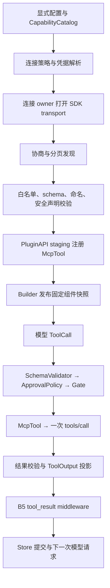

# MCP 客户端工具适配器：开发方案

> 状态：阶段 0–4 已实现（ADR 0035–0039）；各阶段边界以已接受 ADR 与测试为准。
> 编写日期：2026-11-19。
> 本仓库基线：`2291a38e20e351cbc337f2e70f6b26c4300c74fb`。
> 范围：路线图 E1，MCP tools 客户端，stdio 与 Streamable HTTP。
> 实施前将决定提取为下一可用编号的 ADR；不修改已接受 ADR 的历史决定。

## 1. 推荐决定与原因

**把 MCP 做成显式注册的 Tool 适配能力。模型仍然调用普通工具，Agent loop 不理解 MCP 协议。**

| 决定 | 原因 |
|---|---|
| 使用官方 Python SDK，限制在一个已验证版本系列 | 复用协议与传输实现，集中隔离 SDK 变动，不自行维护 JSON-RPC/SSE |
| 发现发生在 Builder/PluginHost 组装期 | 当前工具集和 SessionSpec 是固定快照；不在每轮模型请求中连接、发现或改工具名 |
| McpTool 实现现有 Tool 协议 | 自动继承审批、Gate、超时、取消、B5 结果变换和逐消息持久化 |
| Runtime 级连接，每台 server 有一个连接所有者任务 | 可复用连接，并使 SDK 的异步上下文在同一任务内进入与退出 |
| 完整 JSON Schema 校验放在审批之前 | 远端 schema 比现有子集复杂；不能让未真正校验的调用进入审批或执行 |
| 工具白名单、安全声明由应用决定 | server 提供的 annotations 只能作提示，不能授予权限 |
| 单次 tools/call，不做自动续调或故障重试 | 调用中断不能证明远端副作用没发生；SDK 的便利功能也必须纳入审查 |
| 第一版支持文本与 JSON，明确处理不支持的内容 | 当前 Message/ToolOutput 没有多模态内容块，避免把 base64 当模型文本塞进日志 |

首版不做 MCP server、resources/prompts 的 Agent 接口、OAuth 登录流程、sampling、elicitation、roots 授权、Tasks、多轮 input-required、动态工具热更新或断线自动重放。

## 2. 当前接口能复用什么，哪里确实有缺口

以下均已对照当前源码，而不是按 SDK 名称猜测接口：

| 当前文件/符号 | 复用方式或限制 |
|---|---|
| `ports.py::Tool` | 已有 definition 与 execute(arguments, context)，足够表达远端工具 |
| `domain.py::ToolDefinition` | 已有 input_schema、副作用、审批、超时、retry_safe/replay_safe；没有 output_schema，先由适配器持有，无需扩大所有工具的领域对象 |
| `plugins.py::PluginAPI.register_tool/register_cleanup` | 支持 staging、冲突检查、逆序回滚和释放；可以异步初始化 MCP 插件 |
| `application/capability_catalog.py::CapabilityRegistration` | Settings parser 与 factory 分离；适合 `capabilities.mcp`，无需新增顶层配置键 |
| `application/builder.py::AgentRuntimeBuilder.build` | 插件工具快照并入组件，已有构建失败回滚与 owned/borrowed 管理 |
| `runtime/session_spec.py::SessionSpec` | 工具按实例身份比较，不能假设 server 通知后可原地替换定义 |
| `runtime/loop.py::_execute_tool_calls` | 当前直接调用子集校验函数；这是需要补齐的通用校验接缝 |
| `tools/validation.py::validate_tool_arguments` | 忽略 anyOf/$ref/pattern 等未支持关键字，不能冒充完整 MCP schema 校验器 |
| `runtime/middleware.py` | MCP ToolOutput 返回后自然经过 tool_result 链，无需另造输出 Hook |
| `tools/result_truncation.py` | 只截断 content，不能限制 structured_content、原始 HTTP body 或 SDK 解码内存 |
| `PluginAPI`、`CapabilityFactory` | 当前不提供 EventSink/凭据解析上下文，不能在代码示例里假装已有这些参数 |

### 2.1 实施前补齐的通用接缝

1. **SchemaValidator 端口**：提供 `supports(schema: Mapping[str, JSONValue]) -> bool` 与 `validate(schema: Mapping[str, JSONValue], arguments: JSONObject) -> None`，校验不通过抛现有 ToolValidationError。AgentComponents 增加默认字段 `schema_validator`，默认实现包装现有子集函数，保持已有行为。Profile factory、Builder 覆盖、SessionSpec 身份比较和字段覆盖测试一并跟进。loop 在原位置改为调用端口，其余 MCP 细节不进入 loop。
2. **PluginAPI.event_sink 只读属性**：借用 PluginHost 已隔离的 EventSink。staged API 接收同一个 sink，不取得关闭所有权。用于 MCP 连接与发现事件；standalone 适配器也能显式传入 sink。不暴露 Store 或运行控制权限。
3. **工具超时结果的通用措辞**：现有 `_run_tool` 超时文本只说明超过时间，补充“副作用结果可能未知，不要自动重试”。所有工具都适用，不加入 MCP 专属分支。取消仍原样传播，沿用 Session 的未决工具恢复。
4. **ToolExecutionContext 调用身份**：在末尾增加默认 None 的 run_id/turn_id，沿审批和执行快照传递，turn 非空时必须有 run。所有工具都可用；解决连接 owner 跨任务后不能依赖调用者 ContextVar 的关联问题。

SchemaValidator 的 MCP 实现采用本地 `jsonschema` Draft 2020-12 校验；开发时明确版本与行为。只允许文档内部引用和预先注册的本地资源，禁止通过 `$ref` 自动联网或读取任意文件。格式断言是否启用必须固定，首版不把 format 当强校验；不支持的 dialect/必需 vocabulary 显式拒绝。关于引用机制见 [jsonschema 官方文档](https://python-jsonschema.readthedocs.io/en/stable/referencing/)。

**没有必要新增 AgentComponents.mcp、AgentRuntime.with_mcp_servers 或 MCP 专属主循环。** 连接前检查已显式提供校验器且依赖可用；发现后、注册工具前调用 `schema_validator.supports(schema)` 逐项预检。子集实现对未知断言返回 false，完整实现对不支持 dialect/外部引用返回 false；不支持时关闭连接并构建失败。不要用具体实现的 isinstance 判断能力。普通工具默认仍保留原来的子集行为，不在此次偷偷收紧全部手写 schema。

备选的“在 McpTool.execute 中才完整校验”可以阻止发出错误参数，但校验发生在审批之后，会导致错误参数也请求批准，并丢失统一的 tool_validation_failed 语义，因此不推荐。

## 3. 协议与 SDK 基线

核查时官方 SDK 最新发布为 **v2.3.0**；建议第一轮验证锁定此 tag，optional extra 的初始范围使用 `mcp>=2.3,<2.4` 与显式 `jsonschema` 依赖，后续按测试扩展范围。不要把 main 分支或 v1 教程当成这一版本的契约。[官方发布页](https://github.com/modelcontextprotocol/python-sdk/releases/tag/v2.3.0)

SDK v2 的 Client 支持自动协议探测与旧协议回退。首版连接模式使用 auto，允许已验证的 `2026-07-28` 与 `2025-11-25`，协商到其他版本则关闭并报告不支持。现代协议与旧协议生命周期不同，方案不能统一写成“所有连接先 initialize”。由 SDK 处理协商，归一化层记录最终 protocol_version。[v2 客户端说明](https://github.com/modelcontextprotocol/python-sdk/blob/v2.3.0/docs/client/index.md)

**特别注意便利客户端的调用语义**：v2.3.0 高层 Client.call_tool 包含 input-required 驱动与 HeaderMismatch 后重新发现/重发逻辑。第一版用 Client 管理连接，用公开的 `client.session.call_tool` 做一次请求，显式取得或拒绝 input-required，不开启 claimed extensions，不调用高层自动驱动器。HeaderMismatch 视为目录失效，不在旧 schema 下重发。[固定版本源码：Client](https://github.com/modelcontextprotocol/python-sdk/blob/v2.3.0/src/mcp/client/client.py)、[ClientSession](https://github.com/modelcontextprotocol/python-sdk/blob/v2.3.0/src/mcp/client/session.py)

两种 transport 都采用标准实现，旧式 HTTP+SSE 不作为单独入口。不能因 Streamable HTTP 有 SSE 响应就把它等同于旧 SSE transport。[传输规范](https://modelcontextprotocol.io/specification/2026-07-28/basic/transports)

所有 SDK 类型与 snake_case/camelCase 差异只出现在 sdk.py。核心 domain、ports、runtime 和存储不导入 mcp、mcp_types 或 Pydantic。安装基础包、导入 api、运行普通 Agent 不要求 MCP 依赖已安装。

## 4. 模块与最小契约

建议保持一个 Python 分发包：

```text
src/pi_agent_py/
  tools/schema.py                 # 默认子集与完整校验器；第三方实现延迟导入
  tools/mcp/
    contracts.py                 # 本地 DTO 与窄协议，不依赖 SDK
    sdk.py                       # 两种 transport、协商、SDK 类型与错误转换
    connection.py                # 连接所有者、调用队列、取消、关闭状态机
    tool.py                      # McpTool、命名、结果投影
    plugin.py                    # 发现、选择、原子注册与 cleanup
  application/capabilities/mcp.py # 非秘密 Settings、YAML parser、注册工厂
```

以下为**待实现的接口草案**，不是当前可运行 API：

```python
class McpEndpoint(Protocol):
    async def list_tools(self) -> tuple[McpToolDescriptor, ...]: ...
    async def call_tool(self, name: str, arguments: JSONObject) -> McpCallResult: ...
    async def aclose(self) -> None: ...

class McpConnector(Protocol):
    async def open(self, spec: McpConnectionSpec) -> McpEndpoint: ...

class McpTool:
    @property
    def definition(self) -> ToolDefinition: ...
    async def execute(self, arguments: JSONObject,
                      context: ToolExecutionContext) -> ToolOutput: ...
```

McpEndpoint 是连接代理，调用方不持有 SDK 上下文；默认 FakeMcpConnector 实现同一契约。

- McpToolDescriptor：remote_name、description、input_schema、可选 output_schema、annotations；JSON 字段保存脱离 SDK 的独立快照。
- McpCallResult：有序内容块、is_error、structured_content，另有 has_structured_content，区分未提供与显式 null。
- McpConnectionSpec：已解析的 stdio/HTTP 联合配置与私密凭据；敏感字段 repr=False，不进入工具定义或事件。
- McpToolBinding：server_id、remote_name、local_name、schema_digest、本地安全声明。原 output_schema 留在此层用于结果校验，不添加到普通 ToolDefinition。

Definition/Provider/Consumer/Lifecycle/Evidence 分别对应这些契约、SDK/Fake 实现、McpTool/插件、连接 owner/cleanup，以及第 12 节的离线测试。

## 5. 组装与调用数据流



先提供代码接入 `mcp_plugin(specs, connector, connection_policy, secret_resolver, schema_validator)`，由 Builder.with_plugin 加载；再提供 `mcp_capability_registration(...)`，把同一初始化逻辑用于 YAML。两个入口共享实现，不在 Builder 内新增分支。

SchemaValidator 是借用的同一个实例，调用方同时交给 Builder 和 MCP 注册工厂；工厂负责预检选中 schema，loop 负责每次参数校验。这里显式传依赖，不引入服务定位器。

使用自定义 SessionSpecResolver 时，选择 MCP 工具的组件必须携带对应的完整校验器；这是 resolver 的组装契约，需有集成测试。McpTool 在远端发送边界再次校验原 schema，防止被错误的 resolver 或直接 execute 调用绕过；后者属于防御性校验，不能替代审批前校验。

所有选中 server 默认都是 required：任意连接、发现、schema、名称冲突失败，整次构建回滚。默认不“跳过有问题的 server 继续启动”，否则工具集会随网络状态悄悄变化。暂不提供 optional server 模式。

## 6. 连接生命周期、并发与取消

### 6.1 SDK 上下文由一个任务拥有

不要在 PluginFactory 的任务中 enter Client/AsyncExitStack，再在 Runtime.close 的另一个任务中 exit。SDK 使用异步任务组；项目的 build、run、close 不保证来自同一任务。

每个 server 一个 owner task，在其协程内完成 `async with Client(...)`、接收命令、等待子调用结束及退出。open() 启动 owner 并等待 ready；aclose() 发关闭命令并等待 owner 完成，不直接退出其上下文。open 在等待 ready 时被取消，也必须停掉尚未就绪的 owner。

每次调用由 owner 的结构化子任务执行，拥有独立 cancellation scope。首版每 server 同时执行一项；队列有界，排队时间计入调用总时限。取消等待者只取消自己的子调用，不把 owner 和其他 Session 一起取消。请求从未发出和已交给 SDK 的状态须明确区分。

caller CancelledError → 取消该请求 → SDK 的协议/transport 取消 → 有界等待本地清理 → 继续抛 CancelledError。不能用 asyncio.to_thread 包装 async SDK，也不能只取消 Future 而让远端请求继续无人管理。协议取消不是撤销外部副作用；现代 stdio 与 HTTP 的取消方式也不同，由 SDK 处理。[传输取消规范](https://modelcontextprotocol.io/specification/2026-07-28/basic/transports)

### 6.2 关闭与故障

状态固定为 new → opening → ready → closing → closed；opening/ready 可进入 broken。broken 后新调用立即失败，重新连接通过新建 Runtime/插件完成，不复用可能失效的 SDK Session。

资源对象创建后、下一次 await 前就 api.register_cleanup(endpoint.aclose)。发现失败和后续 server 失败都进入已有 PluginHost 回滚。正常关闭先由 Runtime 停止工作，再 PluginHost 撤销注册，cleanup 逆序关闭连接；aclose 幂等，所有等待者都能获得完成或分类错误。

stdio 必须等待客户端及子进程树退出；HTTP 必须释放响应流与自己拥有的 client。SDK stdio 已有有界关闭处理，适配器仍需验证 Windows 进程树与取消情形；不能只验证“Python Task 结束”。[SDK stdio 实现](https://github.com/modelcontextprotocol/python-sdk/blob/v2.3.0/src/mcp/client/stdio.py)

首版一个 Runtime 对应一个信任主体和固定凭据。不同租户不要共用同一连接。当前 SessionPlugin 只有请求 Hook/观察生命周期，不能动态注册 Session 专属工具；租户连接池与 SessionSpecResolver 的组合另行设计。

## 7. 发现、名称与 schema

tools/list 必须遍历所有分页，有最大页数、工具数、schema 字节数及重复 cursor 检查；禁止只读取第一页。服务器的名称不是本地身份来源，使用应用配置的稳定 server_id。MCP 允许的名字和模型供应商约束也不同。[MCP Tools 规范](https://modelcontextprotocol.io/specification/2026-07-28/server/tools)

建议本地名称为 `mcp__<server_id>__<short_slug>__<digest12>`：

- server_id 限制 ASCII 字母、数字、下划线、短横线，最多 20 字符；local_name 总长不超过 64。
- short_slug 规范化原名并按剩余预算截短，digest12 从规范编码的 [server_id, remote_name] 计算；总是加摘要，不依赖发现顺序。
- 保存原名映射，调用时发送 remote_name；配置白名单也使用 remote_name。
- 所有本地名称预先检查冲突，包括摘要碰撞；冲突直接拒绝，不运行时改名。

只暴露显式 allow_tools 列表；未配置为空，发现了工具也不默认全部注册。配置中列出的名字未发现应构建失败。description 缺省可用稳定说明补齐，限制长度；server instructions 不自动加入 system prompt。

选中工具的 input_schema 必须符合本项目 root object 约束，否则明确拒绝。保留完整原 schema，禁止把不支持部分悄悄删掉再告诉模型“已支持”。默认 dialect 为已支持的 2020-12；先检查 schema 本身，再建立校验器。模型 Provider 若不接受这个 schema，则作为兼容性失败处理；首版不承诺任意 MCP schema 可跨供应商使用。

现代 SDK 可按 x-mcp-header 把参数镜像到 HTTP header。首版对选中 schema 中这种扩展显式拒绝，避免在未设计 header 暴露策略时自动启用；将来单独开放，不通过重发现/重发绕过这一限制。[v2.3.0 的相关行为说明](https://github.com/modelcontextprotocol/python-sdk/releases/tag/v2.3.0)

发现结果绑定 schema_digest 与连接代次。首版无目录订阅和热更新，只固定启动时快照，不声称获知所有远端变化。若收到已有通道传来的 list_changed 或调用返回明确的 stale/header mismatch，就把 endpoint 标记失效并要求重建；不原地更改 SessionSpec。若 server 未通知且悄悄改变工具语义，固定快照无法防止这一点，接入的 server 仍需受应用信任。

## 8. 权限与启动边界

所有 MCP 工具首版固定 `side_effects="external"`、`requires_approval=True`、`retry_safe=False`、`replay_safe=False`。readOnlyHint 等 annotations 只保存为提示，不自动降低权限。应用通过自己的 ApprovalPolicy 与 Gate 的精确工具白名单开放使用。默认 Gate 仍会拒绝 external；不能因发现成功就自动换 TrustedToolExecutionGate。[annotations 信任要求](https://modelcontextprotocol.io/specification/2026-07-28/server/tools)

`coding_profile()` 目前只允许 bash，不会自动允许 MCP。示例应显式选择独立 Profile/Gate，并说明批准调用和 Gate 放行是两个条件。

工具调用审批无法覆盖更早发生的 server 启动和 HTTP 建连。增加适配层的可替换 McpConnectionPolicy，在任何 I/O 前检查 stdio 的 executable/argv/cwd 或 HTTP endpoint。默认配置策略只接纳应用显式批准的精确目标；未审阅的项目配置不得直接启动程序。

stdio 使用 executable + args，不经 Shell，不执行 `!command`，不自动 npx/uvx 下载。cwd 相对配置文件目录解析，不使用进程的偶然工作目录。SDK v2.3.0 会合并基础环境白名单与显式 env，所以 `env={}` 不等于空环境；文档与测试必须如实列出基础继承集合。其他秘密只通过 env_refs 显式注入，禁止传完整 os.environ。[SDK 环境处理](https://github.com/modelcontextprotocol/python-sdk/blob/v2.3.0/src/mcp/client/stdio.py)

显式传入 stdio 的 stderr 目标，默认丢弃原文，避免 SDK 默认 stderr 直通绕过安全事件管线；关闭时由 owner 释放该句柄。排障优先使用退出码和固定错误类别。若未来保留 stderr，必须另设受控、限量且有权限的诊断通道，不能自动写入普通日志或 durable log。

本地 stdio MCP server 仍是宿主子进程，**没有自动进入当前 Docker Bash 沙箱**。ProcessSandbox 是一次性 exact-argv 请求/结果端口，尚不支持长期双向 stdio。首版仅接入已信任的本地 server；需要隔离时由部署侧明确提供容器/外部隔离，后续再设计 ManagedProcess transport。

HTTP 首版支持显式地址和固定 header 凭据，不实现 OAuth。默认 HTTPS；本机明文开发地址须显式允许，拒绝 URL 内嵌凭据，限制重定向目标，保持 TLS 校验。内网 server 可用，但必须在连接策略中明确允许，不对私网地址作通用开放。

## 9. 结果、错误与恢复

### 9.1 投影规则

| MCP 返回 | ToolOutput 行为 |
|---|---|
| text blocks | 按原顺序拼接，保留明确分隔 |
| structuredContent | 深拷贝，先校验原 output_schema，再放入固定结果封装的 result 字段 |
| 仅结构化结果 | content 使用有界、确定排序的 JSON 表示；大结果执行下述预算策略 |
| isError=true | 保留工具错误标志；这是远端工具声明的业务错误，不冒充传输异常 |
| 混合非文本块 | 不存 base64，给出类型省略提示与计数，不自动读取 resource_link |
| 只有不支持内容 | 提交固定的“已调用但结果无法表示，不要自动重试”错误 |
| input_required/非首版结果类型 | 明确 unsupported，停止这一调用，不自动回复或重发 |

建议 structured_content 固定为 `{"mcp": {"server_id": ..., "remote_tool": ..., "schema_digest": ..., "protocol_version": ..., "has_structured_content": ...}, "result": <远端结构化值>}`。这是新增适配器的公开输出契约，不改变普通工具；output_schema 校验对象是远端原值，不是封装对象。显式 null 与缺失分别保留 presence 标志。

远端输出是模型上下文中的不可信数据，不能作为 system instructions。server 的 `_meta`、日志、headers、SDK 原始异常和协议 Session ID 默认不进入 ToolOutput 或观察事件。

### 9.2 预算与输出校验

限制同时覆盖：发现响应、单 schema、调用结果总字节、content 字符数、结构化 JSON 字节与深度。HTTP 的 JSON 响应体和 SSE 事件都要有读取限制；解析后的大小检查不能被描述为解析前的内存保护。SDK 无法提供某项限制时，需要受限 transport 包装并有测试，不能写“使用截断 middleware 就解决了”。

超预算或成功结果不符合 output_schema 时，工具可能已经产生副作用，映射为固定 unknown-result 错误，不保留原文，不重试。B5 可继续施加应用的截断/脱敏；它不是原始接收预算的替代。结构化字段并不受 TruncateToolResults 保护。

schema、参数与结果都是受限大小的有限 JSON 快照。schema 的复杂度也要设界；普通异步 timeout 无法抢占阻塞的同步正则校验，首版不能宣称对任意恶意 schema 有 CPU 隔离保证。

### 9.3 错误分类和一次调用语义

SDK 边界将原始错误链式转换为本地 McpConnectionError/McpProtocolError/McpTransportError/McpResultError；不混入 ModelProvider 的 ProviderError。构建期向上抛出，由既有 RuntimeBuildError/PluginLoadError 回滚。

调用期由 McpTool 把已分类的预期失败映射成稳定 ToolOutput：未发出请求可标记 not_started；请求交给 SDK 后失败一律保守标记 outcome_unknown，正文提醒不要自动重试。诊断事件只含分类、异常类型与关联 ID，不包含原异常文本。内部 SDK 端口的异常链保留，测试直接验证 __cause__；模型看到的是固定结果。

设置内部请求期限小于工具外层硬超时，预留本地取消/清理时间；进度不能无限延长总期限。内部超时转换成 unknown，外层保险超时使用第 2.1 节的通用提示。CancelledError 不转换成 ToolOutput；Session 恢复继续补写现有中断结果。

MCP JSON-RPC request ID、domain ToolCall.id、run_id 是不同身份，不直接复用。超时、断线、重启和 fork 都不重发旧 tools/call。Store 只持久化最终模型可见结果，不持久化活连接、凭据或 SDK session；replay 不要求 MCP server 在线，也不意味着可以重做远端副作用。

## 10. 配置与公开入口

下面仅为新增 capabilities 子树草案，需与现有 version/provider 配置合并使用：

```yaml
capabilities:
  mcp:
    servers:
      notes:
        transport: stdio
        command: ./.venv/Scripts/python.exe
        args: [./local_servers/notes_server.py]
        cwd: .
        env_refs:
          NOTES_TOKEN: NOTES_SERVICE_TOKEN
        tools: [search_notes, read_note]
        call_timeout_seconds: 30
      docs:
        transport: streamable_http
        url: https://docs.example.com/mcp
        header_refs:
          Authorization: DOCS_AUTHORIZATION
        tools: [search]
```

env_refs/header_refs 的值都是变量名，例中 DOCS_AUTHORIZATION 保存完整授权头值，YAML 不保存 token。注册函数借用应用提供的 SecretResolver，只解析明确引用的键；parser 只验证结构和名字，不读取环境。默认 resolver 由应用边界提供 process-env 的受限快照；需要 `.env` 时由应用显式选文件后提供 resolver，不复用只为模型 Provider 设计的 api_key_override，不搜索父目录、不修改 os.environ。

stdio command/cwd 以配置目录规范化；args 保持精确参数，路径含义由应用/server 决定，不对任意参数做 Shell 或环境插值。示例的文件必须事先由应用部署，不能因 YAML 出现命令就下载安装。

建议首版统一默认值：连接及发现总期限 10 秒、每调用 30 秒、额外清理宽限 5 秒；每 server 同时执行 1 项、最多排队 64 项；最多 16 台 server、每台最多发现 256 个工具、暴露 64 个、发现 100 页；单 schema 64 KiB、单台目录总量 1 MiB；单结果原始接收上限 1 MiB、结构化 JSON 上限 128 KiB、content 上限 128 Ki 字符、嵌套深度 32。期限使用可注入时钟/超时测试机制，数量和预算进入强类型 Settings 并验证为正数。上述数值是工程起点，可由显式配置调整，不是 MCP 协议限制。

stdio 与 HTTP 的字段互斥，transport 使用明确判别字段；tools 必须显式提供且非空，不默认暴露远端全部工具。schema 不支持等发现后错误只保证不发布工具，并不承诺“从未建立连接”。

公开入口建议提供 McpTool、McpConnector/McpEndpoint、mcp_plugin、mcp_capability_registration、SchemaValidator 与两种实现。常规 api 导出只引用不依赖 SDK 的定义模块；sdk.py 延迟加载。不要把 mcp.types 或 SDK Client 扩散到稳定 API。SDK v2.3.0 使用 httpx2，不能把现有模型 Provider 的 httpx.AsyncClient 直接当 MCP transport client 复用。

配置通过应用显式扩展 CapabilityCatalog，并将同一 Catalog 交给 loader 与 Builder：内置默认目录仍可只提供 Bash；安装 extra 不产生自动注册副作用。缺依赖时仅在选择 MCP 时给出固定 ConfigurationError 与安装提示。

## 11. 可观测性与证据

复用既有 tool_execution_*、tool_result_transformed、message_committed 与 durable identity。补充 capability 事件：mcp_connection_started/ready/failed/closed、mcp_tools_discovered、mcp_request_started/finished/failed/cancelled；有稳定 span、duration、配置 server_id、连接代次和关联 ID，不含正文。

connect/list 阶段没有 run/turn，允许 envelope 为空；调用阶段显式携带 session/run/turn/call。当前 ToolExecutionContext 没有 run_id/turn_id，因此使用第 2.1 节的通用字段扩展后再接线，不读取 runtime 私有状态。每次请求额外生成 invocation_id 关联 owner 工作项和本地 span，不假设 ToolCall.id 全局唯一。standalone 直接调用 context 可以没有 run/turn。owner 不把上一调用的 ContextVar 当下一调用事实。

事件经 PluginAPI.event_sink 进入既有隔离与脱敏；OTel 新 span 配对需显式映射。server_id/remote_tool 不直接成为无限基数指标标签，日志只使用白名单字段。远端 progress/logging 首版不透传文本；最多输出有界数值进度，不能阻塞工具调用或重置总期限。

工具目录摘要用于排障与 drift 提示，不作为可恢复活连接的 durable state。若未来要求证明每轮精确使用的工具目录和策略版本，需要另设可持久化 manifest 契约；本期不把 best-effort 事件当审计日志。

## 12. 开发阶段与验收

| 阶段 | 原子交付 | 关键验收 |
|---|---|---|
| 0（已完成） | 通用 SchemaValidator、插件观察入口、调用身份、超时语义，见 ADR 0035 | 旧默认行为不变；复杂 schema 在审批前校验；新字段透传完整；超时没有“安全重试”的暗示 |
| 1（已完成） | contracts + FakeMcpConnector + McpTool + 插件初始化，见 ADR 0036 | 无 SDK、无网络、FakeProvider 能发现/调用/提交/续轮；冲突与失败全回滚 |
| 2（已完成） | SDK owner + stdio + 本地 fixture server，见 ADR 0037 | build/run/close 分别在不同任务仍能关闭；取消后无后台任务/子进程泄漏 |
| 3（已完成） | Streamable HTTP + 显式凭据 + 接收预算，见 ADR 0038 | 本机测试 server，无公网；两种协议基线、401、断流、超大结果、HTTP client 关闭 |
| 4（已完成） | YAML capability + 稳定 API + 教学材料，见 ADR 0039 | Catalog 两端显式注入；语法/策略错误无连接，发现错误不发布工具并关闭连接；可复现取消/关闭和多 server 回滚 |

每阶段一个意图提交，默认复用当前分支。不要以“加 MCP”混入其他已知问题修复。

阶段 1 的实现与边界见 [ADR 0036](../adr/0036-mcp-fake-tool-slice.md)、[教程 36](../../tutorials/36-mcp-fake-tools.md)和[示例 37](../../examples/37_mcp_fake_tools.py)。规范 DTO 使用已解析数据预算；Fake 用局部 Lock 验证串行调用与取消隔离。SDK owner、完整分页、队列容量、原始接收预算和凭据解析仍按后续阶段验收；稳定 facade/YAML 入口仍属于阶段 4。

默认快速测试使用 FakeProvider/FakeMcpConnector，不调用付费模型、不下载 server 包。推荐覆盖：

- 分页完整性、循环 cursor、重复原名、规范化/截短/摘要碰撞、allowlist 缺失名字、无 tools capability。
- required/enum/type 列表，以及 anyOf/$defs/$ref/pattern 等复杂 schema；非法 schema、外部引用与不支持 dialect 不得静默放行。
- 默认审批和 Gate 各自拒绝时，远端调用次数为零；不可信 readOnlyHint 不降低 external 声明。
- 多个 Session 共用 endpoint 时的排队、队列容量、取消一个请求不取消另一个请求。
- Client 的 enter/exit 在同一 owner task；ready 前取消、构建失败、显式关闭、重复关闭均不泄漏。
- Text、JSON、显式 null、缺失结构化内容、业务错误、非文本、input-required、output schema 错误与预算超限。
- 远端执行后断流/超时返回 unknown；调用次数始终为一；重启/replay/fork 不发请求。
- SDK 高层的自动重发未被调用；HeaderMismatch 不重新 list 后执行；现代/legacy 取消方式不手工混用。
- 事件 span 配对、日志不含 token/headers/参数/输出/stderr，telemetry 不引入自由文本。
- B5 变换后的结果进入内存和 JSONL 日志，原文不因 MCP 特例绕过变换。
- 缺 extra 时普通 api 仍可导入，选择 MCP 才报可诊断配置错误。

真实 stdio/本机 HTTP 协议测试显式标记，由专门离线集成任务执行；Windows 进程、Temp、socket/asyncio 测试直接按 AGENTS.md 的沙箱外约束执行。默认单元测试不要求 socket/Docker/外网。

教学交付建议：下一可用编号的 `examples/*_mcp_tools.py` 和 `tutorials/*-mcp-client-tools.md`，展示目录 → 审批/Gate → 一次远端调用 → 结果变换 → durable 提交，以及超时/取消/恢复。更新 architecture、learning-path、knowledge-map、upstream-mapping、CHANGELOG 与 roadmap。教程导入正式包，不复制第二套 MCP 实现。

## 13. 上游对照与主动省略

Pi 固定 commit `56b25ff4ebbd8a119ef9185447c7b2416059dbcb` 的 `packages/coding-agent/docs/mcp.md` 已有 stdio/HTTP、工具命名、目录暴露和交互式管理；`packages/coding-agent/src/core/mcp-servers.ts::McpServerRegistry` 负责注册配置。这里借鉴“远端发现转为本地工具”及名称消歧，不照搬其产品配置与管理面。

Python 第一版主动省略 Pi 的用户/项目配置合并、交互重连、工具搜索、OAuth、资源工具化、命令求值和动态 exposure。对 DeepSeek Harness 只沿用本仓库已明确的能力契约、Provider/Consumer 与释放证据，不声称存在未经源码核对的 MCP 一一对应实现。

与直接把 SDK client 塞进 Agent 相比，这个方案多了连接所有者、DTO 映射和测试替身；换来的是 SDK 可替换、失败可复现、关闭可验证，以及运行核心继续只依赖稳定通用端口。
