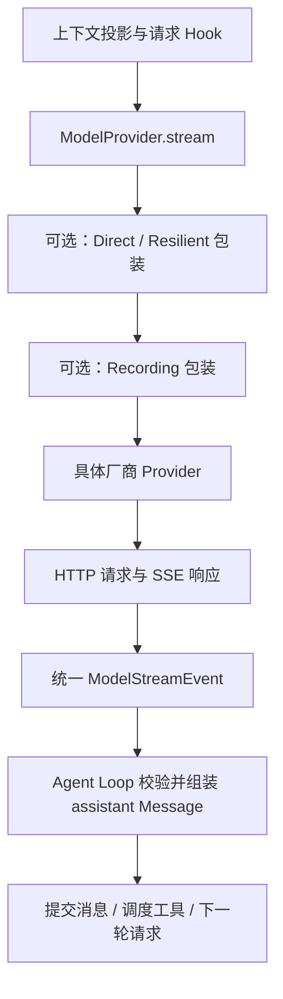

# Providers 接口与输入输出导读

本目录解决的问题：把供应商的 HTTP 请求和流式响应转换成 Agent Loop 能消费的统一事件流。本文依据当前工作区源码及相邻离线测试整理；字段默认值描述本项目实现，不代表供应商最新服务规格。

## 1. 先看边界和数据流



图中为一种组装方式。Recording 放在各原始候选 Provider 外，记录每次物理尝试；放在整个 Resilient 外，记录一次逻辑请求。

三个容易混淆的对象：

- `Message`：一次请求的输入历史，也是 Loop 最后组装的消息对象。
- `ModelStreamEvent`：Provider 的输出，一次只描述一段文本、一个完整工具调用或一个结束标记等。
- `AgentEvent`：运行时向观察者发布的事件，带 live/capability/durable 等通道；它不是 Provider 的返回类型。

Provider 负责协议转换，不执行工具、不决定上下文裁剪、不提交会话历史。工具执行和消息持久化由上层负责。

## 2. 文件职责

| 文件 | 核心对象/函数 | 输入 → 输出 |
| --- | --- | --- |
| [`../ports.py`](../ports.py) | `ModelProvider` | 统一请求参数 → 异步模型事件流 |
| [`../domain.py`](../domain.py) | `Message`、`ProviderRequestContext`、`ModelStreamEvent` | 纯数据契约，无网络 I/O |
| [`deepseek.py`](deepseek.py) | `DeepSeekConfig` / `DeepSeekProvider` | 通用历史 → Chat Completions → 通用事件 |
| [`kimi.py`](kimi.py) | `KimiConfig` / `KimiProvider` | 同上，另处理 Kimi 完成判据和思考回传规则 |
| [`glm.py`](glm.py) | `GLMConfig` / `GLMProvider` | 同上，另处理 request_id、tool_stream 和业务错误码 |
| [`timicc_responses.py`](timicc_responses.py) | `TimiccResponsesConfig` / `TimiccResponsesProvider` | 通用历史 → Responses → 通用事件及 opaque state |
| [`_openai_compat.py`](_openai_compat.py) | `serialize_message/tool`、`normalize_chunk`、`ToolCallAccumulator` | Chat JSON 编解码、工具参数分片聚合 |
| [`_sse.py`](_sse.py) | `iter_sse` | `httpx.Response` → `AsyncIterator[tuple[str \| None, str]]` |
| [`_provider_support.py`](_provider_support.py) | 默认值、配置校验、HTTP 错误分类 | 配置/状态码 → 校验结果/领域错误 |
| [`runtime.py`](runtime.py) | `DirectModelRuntime` / `ResilientModelRuntime` | 相同 Provider 契约 → 尝试追踪、重试与兼容回退 |
| [`recording.py`](recording.py) | `RecordingModelProvider` | 调用参数 → 先保存请求，再转发原事件流 |
| [`__init__.py`](__init__.py) | 导出清单 | 本目录入口导出四家 Config/Provider 及选项类型 |

下游应用优先从 `pi_agent_py.api` 使用稳定接口；阅读实现时再进入具体模块。下划线模块是内部复用机制，不是供应商基类。

## 3. 统一调用接口

`ModelProvider` 在 `ports.py` 中定义为 `Protocol`，实现方不必继承它：

```python
def stream(
    self,
    messages: Sequence[Message],
    tools: Sequence[ToolDefinition] = (),
    *,
    context: ProviderRequestContext,
) -> AsyncIterator[ModelStreamEvent]: ...
```

具体 Provider 使用 `async def` + `yield` 实现。调用 `stream(...)` 得到异步迭代器，通过 `async for` 消费；不使用 `await provider.stream(...)`。

### 输入 A：实例配置 Config

Config 是实例级配置，区别于每次请求的 `messages/tools/context`。四家均为冻结的 dataclass，在构造时校验。

| 字段 | 类型/含义 |
| --- | --- |
| `api_key` | 必填 `str`，不出现在 dataclass repr 中；用于 Bearer 认证 |
| `model` | 模型名；DeepSeek/Kimi/GLM 当前默认分别为 `deepseek-flash` / `kimi-k2.6` / `glm-5.3`；TiMi 必须显式提供 |
| `base_url` | 绝对 HTTP(S) URL；由适配器补 `/chat/completions` 或 `/responses` |
| `timeout_seconds` | 当前默认 `120.0`；传给 httpx，不是整个 Agent run 的总时间预算 |
| `max_tokens` | Chat 三家的可选正整数输出预算；GLM 另限制不超过 131072 |
| `max_output_tokens` | TiMi 的对应字段，可选，设置时至少为 16 |

供应商选项也在 Config 中：

| Config | 专属选项及注意点 |
| --- | --- |
| `DeepSeekConfig` | `thinking` 默认 `disabled`；`reasoning_effort` 需开启 thinking；可选 `user_id` |
| `KimiConfig` | `thinking`、`thinking_keep`、`reasoning_effort`；默认 `None` 表示省略字段；模型能力由 `_validate_model_capabilities` 校验 |
| `GLMConfig` | `thinking`、`reasoning_effort`、`user_id`；合法组合受具体模型约束，不能仅凭选项类型判断 |
| `TimiccResponsesConfig` | `reasoning_effort`、`reasoning_summary`，写入请求的嵌套 `reasoning` 对象 |

这些类接收已经解析好的密钥，不自行读取 YAML、环境变量或 `.env`。配置读取和供应商组装属于 `application/`。

### 输入 B：`messages`

它是本次模型可见的完整有序投影，不保证等于原始持久历史，也不是只传最新用户问题。四家原始适配器均拒绝空序列。

| `Message` 字段 | 含义/限制 | 当前如何进入请求 |
| --- | --- | --- |
| `role` | `system/user/assistant/tool` | 映射消息角色或 Responses item |
| `content` | 文本 `str` | 消息正文；工具结果用它作为文本输出 |
| `tool_calls` | `tuple[ToolCall, ...]`，只允许 assistant | 序列化为模型之前发起的调用 |
| `tool_call_id` | tool 必填 | 将结果关联到模型调用 id |
| `tool_name` | tool 必填 | 领域关联信息；当前 wire serializer 不单独发送 |
| `thinking` | 默认空字符串，只允许 assistant | Chat 按厂商和轮次规则选择性回传 |
| `provider_state` | `tuple[ProviderState, ...]`，只允许 assistant | TiMi 优先回传属于自己的原始 output items |
| `is_error` | 只允许 tool 为真 | 本地状态；当前适配器不单独发送此标志 |
| `structured_content` | tool 的结构化结果 | 当前适配器不单独发送；模型仍通过 content 看到工具文本 |

`ToolCall` 的字段是 `id: str`、`name: str`、`arguments: JSONObject`。领域层使用字典，Chat/Responses 的 wire 格式中 arguments 则是 JSON 字符串。

### 输入 C：`tools`

`Sequence[ToolDefinition]` 默认为空，描述可供模型选择的工具，不是工具执行实例。

- 模型可见部分：`name`、`description`、`input_schema`，其中 schema 顶层必须是 `type: object`。
- 运行时安全信息：`side_effects`、`requires_approval`、`retry_safe`、`replay_safe`、`timeout_seconds`。当前适配器不把这些信息作为 wire 工具字段发送。
- Provider 把模型返回的参数解析成 JSON 对象；具体工具的 schema 校验、审批、超时和执行由运行时负责。

### 输入 D：`context`

这是必填关键字参数，标识请求身份，不是 prompt 或 HTTP 配置。

| 字段 | 语义 |
| --- | --- |
| `request_id` | 一个逻辑请求的稳定 id |
| `attempt_id` | 一次物理尝试的 id；Resilient 重试/回退时会更新 |
| `purpose` | `agent_turn` 或 `compaction` |
| `request_number` | 逻辑请求序号，必须大于 0 |
| `attempt` | 尝试序号，默认 1，必须大于 0 |
| `session_id` | 可选的会话关联 |
| `run_id/turn_id` | `agent_turn` 必填；turn_id 存在时必须有 run_id |
| `parent_request_id/cause_event_id` | 可选的父请求和原因事件关联 |

DeepSeek、Kimi、TiMi 原始适配器当前不使用 context；GLM 将 `context.request_id` 写入 payload，另要求长度 6–64。包装器仍需要它来记录、路由和追踪。

## 4. 输出：六种统一事件

`ModelStreamEvent = TextDelta | ThinkingDelta | ToolCall | ProviderState | TokenUsage | Finish`。

| 事件 | 字段 | Loop 的消费方式 |
| --- | --- | --- |
| `TextDelta` | `text: str` | 拼接为 assistant.content，发布 live text_delta |
| `ThinkingDelta` | `text: str` | 拼接为 assistant.thinking，发布 live thinking_delta |
| `ToolCall` | `id/name/arguments` | 收集完整调用，随后由工具子系统校验和调度 |
| `ProviderState` | `provider: str`、`item: JSONObject` | 保存进 assistant.provider_state；不发布内容到观察事件 |
| `TokenUsage` | `input_tokens/output_tokens/total_tokens: int`、`cached_input_tokens: int \| None` | 保存本请求最近一次用量，最终发布 model_usage |
| `Finish` | `reason: stop/length/tool_calls` | 标识一条 assistant 消息完成，不代表整个 Agent run 完成 |

`ToolCall` 不是原始参数增量。Chat codec 按 index 聚合 arguments 字符串，收到 finish_reason 时解析后输出；TiMi 按 output item 聚合，在 item.done 时输出完整调用。

Loop 当前实施的协议校验（见 [`../runtime/loop.py`](../runtime/loop.py) 的 `_request_model` 相关消费逻辑）：

- 必须恰好有一个 `Finish`；流结束而无 Finish 是 `ModelProtocolError`。
- Finish 后不能再有文本、思考、工具调用或 ProviderState；允许后续 TokenUsage。
- 同一次响应的工具调用 id 不能重复。
- 有工具调用时结束原因必须是 `tool_calls` 或 `length`；`tool_calls` 结束原因必须伴随调用。

工具续轮的概念轨迹（示意，不是固定事件顺序）：

```text
输入 messages = [user("查天气")], tools = [weather 定义]
输出 ThinkingDelta(...) -> ToolCall(id="c1", name="weather", arguments={...})
     -> TokenUsage(...) -> Finish("tool_calls")
Loop 组装并提交 assistant(tool_calls=[c1])，执行工具
下一次输入 = [user, assistant(tool_calls=[c1]), tool(tool_call_id="c1", content="...")]
下一次输出 TextDelta("天气晴朗") -> TokenUsage(...) -> Finish("stop")
```

## 5. 两套 wire 协议及厂商差异

| 项目 | DeepSeek / Kimi / GLM | TiMi Responses |
| --- | --- | --- |
| 请求地址 | `POST {base_url}/chat/completions` | `POST {base_url}/responses` |
| 历史字段 | `messages` | `input` |
| function 工具定义 | `{type: function, function: {name, description, parameters}}` | `{type: function, name, description, parameters, strict: false}` |
| 工具结果 | `{role: tool, tool_call_id, content}` | `{type: function_call_output, call_id, output}` |
| SSE 解码 | `choices[0].delta` / `finish_reason` / `usage` | `type: response.*` 的 typed events；校验 SSE event 名与 type 一致 |
| 状态续传 | 按策略发送 reasoning_content | `store: false`，请求包含 `include: [reasoning.encrypted_content]`，保存并回传 opaque items |

细节必须保留在具体适配器中：

- **DeepSeek**：`thinking=enabled` 且本次存在 tools 时回传 assistant reasoning_content，允许空值；收到 `[DONE]` 直接结束，未像 Kimi/GLM 那样强制检查该标记。Finish 可能先于 usage，缺少 Finish 的情况由 Loop 检出。
- **Kimi**：要求 `[DONE]` 和唯一 finish_reason；缓冲最后一次 usage，在流尾按 usage → Finish 输出。K3/K2.7 Code 回传思考，`thinking_keep=all` 也保留思考；K2.6 默认仅回传最近 user 后的思考，并受 thinking 设置约束。
- **GLM**：同样要求 `[DONE]` 和 finish_reason，流尾 usage → Finish；仅回传最近 user 后且带工具调用的 assistant 思考。按模型能力添加 `tool_stream: true`；不采用 DeepSeek/Kimi 的 stream_options 字段。
- **TiMi**：`output_item.done` 生成 owner 为 `timicc-responses` 的 ProviderState；下一轮有属于自己的 state 时，优先回传这些 items，而非重复构造文本/调用。`response.completed` 输出正常 Finish；`response.incomplete` 仅将 `max_output_tokens` 映射成 length，其他原因报错；缺少终态事件也报错。

不要假设所有 Provider 都以 Finish 作为最后一个 yield。消费者应读到迭代结束，才能获得尾部用量并确认没有后续协议错误。

## 6. 包装器：输入输出不变，执行保障不同

| 包装器/策略 | 接口与行为 |
| --- | --- |
| `DirectModelRuntime(provider, ...)` | 实现同一 stream；调用一次，发布 route/attempt 事件，保留原异常 |
| `ResilientModelRuntime(candidates, ...)` | 实现同一 stream；按路由顺序尝试 ProviderCandidate，组合 retry/backoff 策略 |
| `CapabilityRoutePolicy.select(...)` | candidates/messages/tools/context → 有序候选序列；过滤 purpose、工具能力、最近带 provider_state 的 assistant 的 owner |
| `DefaultRetryPolicy.decide(failure)` | AttemptFailure → RetryDecision(action, reason)；action 为 retry_same/try_next/fail |
| `FullJitterBackoff.delay_seconds(failure)` | AttemptFailure → 非负秒数；指数抖动，支持数值 Retry-After |
| `RecordingModelProvider(provider, store, target)` | 保存 RecordedModelRequest 后才转发；保存失败或取消时不请求模型；输入深拷贝隔离 |

默认重试规则：输出前的限流、超时、传输和可重试 HTTP 错误才重试；每候选默认最多 2 次，总尝试默认最多 4 次。任何统一事件一旦 yield，就视为 output_started，此后不再重试/回退，避免重复输出。

Resilient 默认 `max_elapsed_seconds=30` 是安排尝试和退避时检查的预算，不会强制中断正在进行的 HTTP 请求。单次请求仍受适配器的 httpx 超时与上层取消约束。候选不兼容会抛 `ProviderRoutingError`；可重试尝试预算耗尽会抛 `ProviderExhaustedError`；不可重试错误通常直接向上传播。

Recording 的输入是 `ModelRequestTarget(provider, model, parameters)` 和 ModelRequestStore。它记录规范化调用参数，不记录原始 HTTP 请求；target 由组装方显式传入，parameters 不应含凭据、headers 或 URL。存档证明请求已经准备好，不能据此推断已经发送或成功响应。保存的 messages 可能包含工具结果和 opaque state，不能当作可公开的脱敏日志。

## 7. 错误与资源生命周期

| 情况 | 对外结果 |
| --- | --- |
| Config 字段/能力组合非法 | `ConfigurationError` |
| HTTP 401/403 | `ProviderAuthenticationError` |
| HTTP 402 或厂商余额耗尽分类 | `ProviderBalanceError`；Kimi 429 quota、GLM 429 code 1113 也属此类 |
| 普通 HTTP 429 | `ProviderRateLimitError`，可能带 retry_after_seconds |
| 其他非 200 | `ProviderHTTPError`；通用分类对 5xx 标记 retryable |
| httpx 超时 / 传输失败 | `ProviderTimeoutError` / `ProviderTransportError`，保留异常链 |
| 非 SSE、错误 JSON、工具参数非对象、流终态异常等 | `ProviderResponseError` |
| Loop 检测事件顺序或结束语义不合法 | `ModelProtocolError` |
| 请求记录存储抛非领域异常 | 包装为 `SessionStorageError`；已有 AgentError 原样传播 |
| asyncio 任务取消 | `CancelledError` 继续向上传播，不包装成普通模型错误 |

四家原始 Provider 支持异步上下文管理和幂等 `aclose()`：内部创建的 httpx client 由 Provider 关闭；调用方注入的 client 仍由调用方关闭。Direct/Resilient/Recording 借用底层资源，由组装方管理关闭；`ModelProvider` Protocol 本身只声明 stream，没有统一关闭方法。

## 8. 对照测试与阅读路径

建议按 `ports.ModelProvider` → `domain` 输入输出 → `deepseek.stream/_build_payload` → 共享 codec → 其他厂商差异 → 包装器 → Loop 消费的顺序阅读。

| 需要核实的问题 | 离线测试 |
| --- | --- |
| Chat 请求形状、文本/工具/思考归一化、错误、取消和 client 所有权 | `tests/test_deepseek_provider.py` |
| DONE 判据、尾部 usage、模型思考策略 | `tests/test_kimi_provider.py` |
| request_id、tool_stream、业务错误和模型能力 | `tests/test_glm_provider.py` |
| typed SSE、function call、opaque state 回传 | `tests/test_timicc_responses_provider.py` |
| 重试、回退、输出后失败、路由和退避 | `tests/test_model_runtime.py` |
| 请求快照、先记录后发送、存储失败和尝试身份 | `tests/test_model_request_recording.py` |

这些测试使用 FakeProvider、httpx MockTransport 等替身，不需要付费 API。涉及 asyncio 或 tempfile 的测试，在 Windows 受限沙箱按仓库 AGENTS.md 使用沙箱外离线命令执行。

可运行入口：`examples/18_provider_request_context.py`（请求身份）、`examples/21_minimal_http_sse.py`（默认离线协议示例）、`examples/23_provider_resilience.py`（重试与路由）、`examples/44_request_recording.py`（请求记录）。教程解释和上游概念映射见现有 `docs/architecture.md`、`docs/upstream-mapping.md` 以及 `tutorials/`，本文只索引当前接口，不改变架构或供应商行为。
