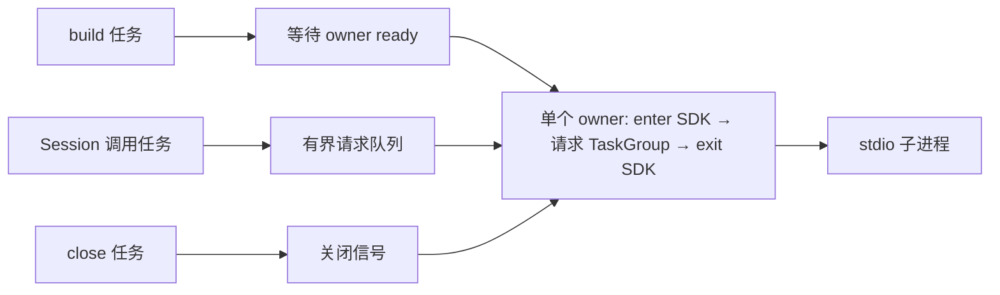

# 37：MCP 连接所有者与真实传输

上一章证明了工具语义；本章把 Fake endpoint 换为官方 SDK，实现真实 stdio。问题发生在应用 build/close 与工具执行之间：SDK 的异步上下文需要同一任务进入、退出，调用方任务却可能不同。

## 运行 stdio

```powershell
.venv/Scripts/python.exe -m pip install -e "python-pi-agent[mcp]"
.venv/Scripts/python.exe -B python-pi-agent/examples/38_mcp_stdio_tools.py
$env:PI_AGENT_MCP_INTEGRATION='1'
.venv/Scripts/python.exe -B -m unittest discover -s python-pi-agent/tests -p test_mcp_stdio.py
```

依赖安装需要包源；示例只运行仓库 `_mcp_demo_server.py`，模型是 FakeProvider。集成测试明确开启本地进程；默认测试使用 Fake 和脚本 Session，不需要进程、网络或付费模型。

## 为什么需要 owner



`connection.py::OwnedMcpEndpoint` 在新的空 Context 中启动 owner，不继承创建它的某个 Session 的隐式身份。工具事件仍由 McpTool 使用显式 ToolExecutionContext 关联 run/turn。每个请求是 TaskGroup 管理的子任务，取消等待者只取消自己；owner 不因一个 Session 取消而退出。

首版同一连接执行一项，默认最多待执行 64 项，排队也计入期限。满队列或失效连接在发送前拒绝，输出 outcome=not_started；已经交给 SDK 的失败使用 outcome_unknown。两者都没有自动重发。`aclose()` 发送关闭信号并等待 owner 退出；不在调用方直接退出 Client。

## SDK 接缝

`sdk.py` 固定验证 mcp/mcp-types 2.3.0。使用 Client 协商 modern 或 legacy，关闭缓存；工具操作通过 Session.send_request。这样不触发高层自动续答/重发，也不让 SDK 修改目录、缓存 x-mcp-header 映射或代替本项目的输出校验器。原 input/output schema 经 DTO 快照进入前章的普通工具链。

发现会逐页读取，有页数、工具数、目录、schema 和 cursor 循环限制。收到已有通知通道的 list_changed 或协议错误后，固定快照失效；重新连接需要新建 Runtime。当前没有目录订阅、动态 exposure 或自动重连。

stdio 只执行明确 argv，不经过 Shell。env 是显式额外变量；SDK 仍继承固定基础名单：Windows 为 APPDATA、HOMEDRIVE、HOMEPATH、LOCALAPPDATA、PATH、PATHEXT、PROCESSOR_ARCHITECTURE、SYSTEMDRIVE、SYSTEMROOT、TEMP、USERNAME、USERPROFILE；POSIX 为 HOME、LOGNAME、PATH、SHELL、TERM、USER。它不会继承完整环境，但也不是空环境。

stderr 被丢弃；SDK 原始日志在 owner 的 Context 内被可撤销过滤器屏蔽，Harness 的 capability 事件保留安全类别和关联 ID。没有修改全局日志级别或留下卸载后的过滤器。生产排障不要把 SDK 原始异常链直接写入普通日志。

## 观察和失败

示例打印 mcp_connection_started/tools_discovered/ready，调用时打印 mcp_request_started/finished，最终 mcp_connection_closed。工具结果包含真实 fixture PID；关闭时等待 SDK 回收进程。异常仍保留安全事件和 cause，不透传异常文本。

`test_mcp_connection.py` 用 Event 阻塞点证明未就绪取消、请求取消隔离、队列上限和清理失败。`test_mcp_sdk.py` 脚本化覆盖分页循环、原 schema、显式 null、业务结果和 HeaderMismatch 不重发。真实 stdio 集成另外验证两个协议基线、远端取消、突然退出及 Windows 子进程树；退出前取得进程句柄，避免把退出后 OpenProcess 的权限竞态误判成存活。

练习：分别从三个 asyncio Task build/run/close；阻塞第一次调用，排队第二次后取消第一项；把目录 cursor 改成循环；在远端执行后断开连接并证明调用次数为一。能够区分未发送、结果未知和 durable 恢复，才算掌握本阶段。

当前阶段未实现 HTTP、凭据解析和 YAML，解析后的预算也不是原始传输读取限制。关闭宽限默认 10 秒、owner 本地清理默认 8 秒，为 SDK 平台关闭留出空间。SDK/stdio 不自动进入 Bash 的 Docker 沙箱。取舍见 [ADR 0037](../docs/adr/0037-mcp-sdk-owner-and-stdio.md)。Pi 仍仅映射固定 commit `56b25ff4ebbd8a119ef9185447c7b2416059dbcb` 的 McpServerRegistry；owner 与独立生命周期是本项目的端口实现，不照搬产品管理层。DeepSeek Harness 对应可替换 Provider 与释放证据思想。
