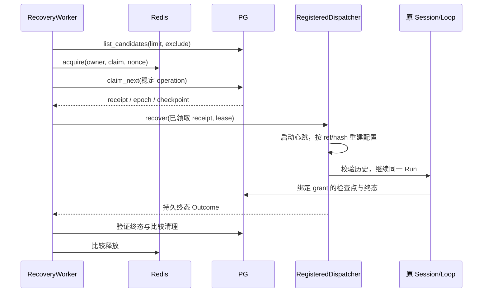

# 第 53 章 两个 Worker 如何接管同一个 Run

本章解决执行进程消失后“谁发现、谁重建、谁继续”的问题。上一章的显式 resume 已证明检查点能继续原 Run；本章让独立 Worker 发现它，同时保留同一 Session 的顺序、配置和安全边界。

## 运行正式示例

准备专用开发 PostgreSQL 与 Redis，在仓库根目录运行：

```powershell
.\.venv\Scripts\python.exe -m pip install -e './python-pi-agent[postgres,redis]'
$env:PI_AGENT_POSTGRES_DSN='postgresql://postgres@127.0.0.1:5432/pi_agent_dev'
$env:PI_AGENT_REDIS_URL='redis://127.0.0.1:6379/0'
.\.venv\Scripts\python.exe python-pi-agent/examples/56_recovery_workers.py --migrate
.\.venv\Scripts\python.exe python-pi-agent/examples/56_recovery_workers.py --partial-stream
```

示例创建独立 `pi_recovery_demo` schema，迁移仅由 --migrate 显式执行；历史留在开发库供观察。两个 Worker 使用独立 pool/client，全部模型行为来自 FakeProvider。run_once 让每次扫描可观察；正式后台运行用 start/aclose，或通过根 Builder.with_recovery 绑定生命周期。

默认在 A 已提交最终 assistant 后注入中断：A 返回 retry，检查点 awaiting_boundary；B 恢复 completed，attempt/epoch=2，prompt_count=1，model_requests_A_B=[1, 0]，old_writer_rejected=True。--partial-stream 在流中断开：半条 assistant 不持久化，B 从 awaiting_model 重试，模型请求数 [1, 1]，持久派发预算继续增长。故障代理只包装正式 writer，不维护第二套执行循环。

## 从候选到执行



扫描只提供候选。Worker A/B 看到相同 Session 也不能同时通过 PG claim。Redis 丢失时 B 可能先获取 key，PG 仍拒绝有效旧许可；旧许可结束或到期后才递增 epoch。完成后 A 的迟到写入必须失败。

每个 Worker 的 active 表限制本地每 Session 一个任务；max_concurrent_sessions 允许其他 Session 继续。忙候选有冷却，list_candidates 在 SQL LIMIT 前排除活跃/冷却 Session，避免队头长期占用扫描额度。冷却表容量、查询数量、超时均有上限；这不提供无限规模下的全局公平调度保证。

## 注册配置与资源

RegisteredRecoveryDispatcher 的工厂表以 `(ref, hash)` 为键。工厂根据 receipt 使用正式 Builder 组装原 profile、Provider、工具、权限和 workspace，并返回新 Runtime。hash 必须由应用覆盖这些执行条件；不能只比较相同字符串就宣称权限正确。workspace/权限校验失败时抛 RecoveryConfigurationError 对应稳定 code；缺失注册表也会明确失败，绝不换成默认工具。

心跳在工厂前启动，所以慢重建也受失租与超时控制。基础设施必须借用 dispatcher 对应的 reader/store/leases，owner 一致；返回的 Runtime 不装 RecoveryWorker，避免递归扫描。每个 Run 的 Runtime 在 attempt 结束后关闭。构建失败由 Builder 回滚，已经返回的资源由 dispatcher 关闭。

Builder.with_recovery 接受端口与设置，根 Runtime 拥有 Worker。运行时先停止扫描，再取消/等待已接管工作与心跳，最后释放资源。默认 shutdown_grace=0；设置正值允许活动任务有界排空。恢复任务中的新 follow-up 已经 durable accepted，因此关闭临时 Runtime 保留队列，下次扫描再执行，本地 handle 会明确说明作用域关闭。

## 复用检查点和补偿

恢复不调用 submit，也不再 claim。共享校验器检查 prompt/assistant 的 event_id、sequence、run_id 与 control 交付；不一致时拒绝派发。before_prompt 提交一次输入；awaiting_model 继续请求编号与预算；awaiting_boundary 使用已持久 assistant，最终回答无需新推理。

awaiting_tools 复用正式 interrupted_tool_result：已提交结果保持不变，只补齐缺失调用，包含正确 call ID、工具名称、is_error 和 recovery provenance。结果 unknown 不表示外部动作失败，不能自动重试。权限、审批、工具派发门仍在同一正式 loop 中生效。

配置拒绝、达到请求/attempt 上限可以形成确定 failed；丢许可、父级中断和存储不确定保留 running。COMMIT 回包丢失时查询原 operation_id，查不到就停止本次 attempt，不能重新执行工具来猜测结果。

## 可重复验证

在仓库根目录执行离线聚焦测试：

```powershell
Push-Location python-pi-agent/tests
..\..\.venv\Scripts\python.exe -B -m unittest test_recovery_worker test_distributed_runtime test_lease_heartbeat test_api -v
Pop-Location
```

显式真实服务测试（仅使用专用开发实例）：

```powershell
$env:PI_AGENT_POSTGRES_TEST_DSN='postgresql://postgres@127.0.0.1:5432/pi_agent_test'
$env:PI_AGENT_REDIS_TEST_URL='redis://127.0.0.1:6379/0'
Push-Location python-pi-agent/tests
..\..\.venv\Scripts\python.exe -B -m unittest test_postgres_recovery test_redis_pg_heartbeat test_postgres_execution test_postgres_session_store -v
Pop-Location
```

Windows 受限沙箱中按 AGENTS.md 直接在获准的沙箱外离线执行异步测试。test_postgres_recovery 使用两个独立 pool/client，并通过 stdout 屏障定位子进程部分流，再强制终止这个子进程。仅推进隔离 schema/前缀的服务端许可，不用固定 sleep 猜 TTL。

真实 Redis 进程重启测试另需设置 `PI_AGENT_REDIS_TEST_RESTART_CONTAINER` 为专用容器 ID/名称；条件和副作用见[故障矩阵](../docs/design/phase-1-recovery-fault-matrix.md)。例如本次独占服务名称为 pi-agent-redis-step7-demo 时，设置该变量后单独运行 `test_postgres_recovery.PostgresRecoveryTests.test_real_redis_restart_preserves_pg_epoch_and_stops_old_worker`，结束后移除变量。测试会核对任务标签和固定回环端口，关闭该临时 Redis 的持久化并重启；没有额外变量时跳过该项，不影响其他集成测试。

完整场景与原阶段测试的对应见[故障矩阵](../docs/design/phase-1-recovery-fault-matrix.md)。掌握标准：能解释两个许可的分工，证明同 Session 串行且不重复 prompt/最终推理，复现工具 unknown 补偿，并从 trace 区分“确定失败”与“本 attempt 停止”。

Pi 对照沿用固定 commit `56b25ff4ebbd8a119ef9185447c7b2416059dbcb` 的 `packages/coding-agent/src/core/agent-session.ts::AgentSession` 会话编排职责；本项目的 Worker/PG epoch/配置工厂是 Python 自身设计。DeepSeek Harness 对照显式能力端口、生命周期和证据，不复制多包或生产控制面。阶段 8 再提供统一开发环境与 benchmark；本章不承诺外部副作用 exactly-once 或生产恢复延迟。
